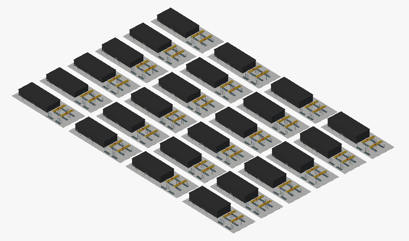

# BigStep — FreeCAD addon for very large STEP files (OCCT 8 engine)

From inside FreeCAD you pick a STEP file. The addon starts an **external OCCT 8.0.1
process** that does the heavy work, then loads a lightweight result into FreeCAD.
If OCCT crashes or hangs on a bad part, only that part is lost. FreeCAD keeps running.

```
FreeCAD 1.1.4 (OCCT 7.8.1)                       engine: Python 3.12 + OCP (OCCT 8.0.1)
 BigStep ▸ Import large STEP…
   └─ QProcess ─────────────────────────────▶ bigstep_engine.py (orchestrator, no OCCT)
                                                 ├─ occt_read.py   parse + XCAF transfer,
                                                 │                 split into parts/<pid>.bin
                                                 └─ occt_worker.py × N  (parallel)
   ◀── JSON events (progress, memory, parts) ──     BRepCheck → ShapeFix → BRepMesh
                                                    → parts/<pid>.brep, meshes/<pid>.stl
   ◀── manifest.json ─────────────────────────
 build document: Mesh previews + App::Link tree
 select parts ▸ Load B-Rep  (real geometry on demand)
```

## Install

1. **Addon:** install *BigStep* with FreeCAD's Addon Manager, or clone this
   repository into FreeCAD's `Mod` folder.
2. **Engine:** open **BigStep ▸ Settings ▸ Install engine…**. It looks for
   Python 3.11–3.14 on your PATH (not FreeCAD's own) and creates a venv in
   FreeCAD's user data folder, under `BigStep/engine-venv`. It then installs
   `cadquery-ocp==8.0.1.1.0` (OCCT 8.0.1, about 300 MB) and `numpy`, and runs the
   engine check. The engine lives outside the addon folder, so addon updates
   keep it.

Requirements: FreeCAD ≥ 1.0. Tested on Linux with FreeCAD 1.1.4 (AppImage).
Windows and macOS are untested. The engine falls back to OCCT's normal transfer
where the fast-transfer hook is not available. Use an AppImage or a regular
build, not the snap. The snap is strictly confined, so it cannot start the
external engine.

For development, run these from a clone:

```bash
./install_freecad.sh 1.1.4   # optional: download, verify SHA256, extract the AppImage
./setup_engine.sh            # engine venv in ./.venv-occt8 (found automatically)
./install_addon.sh           # link this repo into FreeCAD's Mod folder like the Addon Manager does
tests/run_tests.sh           # engine + FreeCAD round trip, with an injected crash and hang
```

## Usage

Switch to the **BigStep** workbench:

- **Import large STEP…** opens a dialog with worker count, mesh deflection and a
  per-part timeout. It shows stage, elapsed time, reader and worker memory, live
  per-part status, problem parts and the engine log, and it has a Cancel button.
  The engine kills its workers on cancel. When the engine finishes, the result is
  loaded automatically (optional).
- **Open processed result…** reloads a `manifest.json` from an earlier run. The
  heavy work runs once per file.
- **Load B-Rep for selection** swaps the mesh preview of the selected parts or
  sub-assemblies for the real, healed B-Rep. It works on tree items and 3D
  picks, and every instance switches at once. **Back to mesh preview** reverses it.
- **Processing report** shows timings, peak memory, and parts that crashed,
  timed out, failed, were healed or are still invalid.
- **Settings…** sets the engine Python path, output root, angular deflection
  and the 3D view options. *Install engine…* sets up the engine. *Check engine*
  shows the engine's OCCT version next to FreeCAD's.
- **Show selectable parts here / Back to fast preview** switch areas between
  the fast preview and the per-part view. See below.

Output goes to `<step dir>/<name>.bigstep/`. If that folder isn't writable, it
goes to `~/.cache/bigstep/`.

## Smooth 3D view for large models

FreeCAD's 3D view (Coin3D) walks every object on one CPU core each frame, and
OpenGL takes draw calls from one thread. At thousands of instances that walk,
not the triangle count, limits the frame rate, while the GPU sits mostly idle.
BigStep handles this in two layers. Numbers below are from the open benchmark
model generated by `tests/make_layout_step.py` with default arguments: 24 areas,
296 distinct parts, 2,928 instances, 61 M rendered triangles, 396 MB STEP. The
machine was a Xeon E5-2660 v3 with an RTX 4000 Ada on Linux/X11. Each figure is
the mean of 60 repaints while rotating.

| View | ms per frame | FreeCAD memory |
|---|---|---|
| FreeCAD defaults (no VBO, render cache Auto) | 7,753 | 2.1 GB |
| Per-part view, VBO | 65 | 3.0 GB |
| Per-part view, VBO + render cache Distributed | 38 | 7.2 GB |
| **Fast preview** (24 merged chunks, 3.5 M triangles) | **17** (60 Hz vsync limit) | 4.3 GB |



The engine processes this model in 3 min 28 s with 16 workers: parse 70 s,
transfer 42 s, then parts and the preview. Regenerate it with
`.venv-occt8/bin/python tests/make_layout_step.py layout.step`.

1. **View settings:** BigStep turns on `UseVBO` and `RenderCache = 1` when it
   loads a model and when the workbench is activated. Live views pick up the
   change. Turn it off in **BigStep ▸ Settings ▸ 3D view**.
2. **Fast preview:** the engine's last stage (`engine/preview.py`, about 15 s
   for the benchmark model with 16 processes) bakes all instances of each
   *area* into a few large meshes. Colors stay per instance through per-part
   material binding, so a model with many colors does not multiply the draw
   calls. An area is one component of a root assembly, such as one building. Heavy parts
   (≥ 20 k triangles) are simplified by vertex clustering. The cell is 0.5 % of
   the part diagonal and never more than half the part's thinnest extent, so
   slabs keep their faces. Simple parts are copied unchanged, because
   simplifying them shifts coplanar faces and causes z-fighting. The addon
   draws the chunks through `SoBrepFaceSet`, which uses VBOs, and makes them
   unpickable, because ray-picking millions of triangles stalls the UI.

The preview is for viewing only. To click, select, edit or load B-Rep, select
an area, assembly or part in the tree and use **Show selectable parts here**.
That area switches to the per-part view in about 0.1 s. **Back to fast preview**
reverses it. With nothing selected, it reverses every area. **Load B-Rep for
selection** switches its areas automatically.

- Build or rebuild the preview of an existing result with
  `bigstep_engine.py preview <out_dir> [--lod 0.005]`. Use `--lod 0` for no
  simplification, or `run … --no-preview` to skip it.
- Turn off the preview in Settings to get the plain per-part document.
- Known limitation: *Save picture* renders offscreen, and preview chunks can
  be missing there. The on-screen view is complete.

## Document layout

```
<file>.step              App::Part (visible): one App::Link per area (component of a
                         root assembly), hidden while that area is in the fast preview
BigStep_Preview          fast preview (merged chunks); DetailAreas = areas shown as parts
BigStep_Library          hidden
  Parts                  Mesh::Feature per distinct part  (+ Part::Feature once B-Rep is loaded)
  Assemblies             App::Part per assembly definition, containing App::Links
```

The object count is roughly distinct parts plus assembly components, not total
instances. Repeated parts and sub-assemblies are links to a single definition.

## Part status

| status | meaning |
|---|---|
| ok | valid B-Rep, meshed |
| healed | BRepCheck failed, ShapeFix repaired it |
| invalid | still invalid after ShapeFix (or healing timed out and the part was meshed unhealed); loaded but flagged |
| failed | empty or unreadable shape, or no triangles |
| crashed | the worker died on this part (segfault/abort). The part is skipped; `parts/<pid>.bin` is kept for debugging |
| timeout | the part exceeded the per-part timeout twice: once healing, once on the unhealed retry. The worker was killed each time and the rest of its batch was re-queued |

## OCCT 8 notes found while building this

- `TopoDS::Shell(...)` etc. are namespace functions now; OCP exposes them as
  `TopoDS.Shell` instead of the old `TopoDS.Shell_s`.
- `Bnd_Box::Get()` returns a `Limits` struct. Use `CornerMin()`/`CornerMax()`.
- OCCT 8 writes binary B-Rep in the same format versions (1–4) as 7.8, but
  FreeCAD's `Shape.importBinary` expects FreeCAD's own layout. FreeCAD-facing
  files are therefore ASCII B-Rep with TopTools format v3, which OCCT 7.8 reads.
- **Fast transfer (default):** on large files most of the STEP read time is
  OCCT's built-in ShapeFix during transfer, which runs on one core. OCCT 8
  controls it only through `SetShapeProcessFlags(std::bitset<18>)`, which OCP
  cannot pass. `engine/occt_flags.py` calls the exported C++ method through
  ctypes and checks the result: it verifies the object pointer and reads the
  flags back, and falls back to OCCT's default if either check fails. The
  workers then heal each part in parallel. Turn it off with `--transfer full`
  or the checkbox in the dialog. The string parameter maps
  (`FromSTEP.FixShape.*Mode`, `read.step.sequence`, `exec.op`) do **not**
  disable it in 8.0.1.
- **Healing like the transfer does:** OCCT heals each shape with the length
  uncertainty of its STEP representation context (often 1e-5 to 0.1 mm), not
  with ShapeFix's 1e-7 default. The vertex tolerances of an unhealed shape do
  not carry that value, so a plain `ShapeFix_Shape` leaves parts invalid that
  the transfer would have healed. The reader therefore lists the file's
  declared uncertainties in `tolerances.json`. A worker first tries the part's
  own tolerance, then each declared value in ascending order (max tolerance
  1 mm), until BRepCheck passes.
- Some huge parts take 10–15 minutes to heal. Parts are queued largest first,
  one per batch, and the default per-part timeout is 1200 s. A part that still
  times out is retried once **without healing**, so it still loads, flagged
  `invalid`.
- OCCT prints to stdout. The engine moves fd 1 to stderr and keeps the JSON
  event stream on a private fd.

## Engine CLI (usable without FreeCAD)

```bash
.venv-occt8/bin/python -E -s BigStep/engine/bigstep_engine.py check
.venv-occt8/bin/python -E -s BigStep/engine/bigstep_engine.py run in.step out.bigstep \
    --jobs 16 --deflection 0.002 --angular 20 --part-timeout 1200 --transfer fast
```

Test hooks: `BIGSTEP_TEST_CRASH=p000007` makes a worker abort on that part id.
`BIGSTEP_TEST_HANG=p000013` makes it hang while healing, so the unhealed retry
succeeds. `BIGSTEP_TEST_HANG_ALWAYS=p000020` makes it hang on the retry too.

## License

MIT, see [LICENSE](LICENSE). The engine uses OCCT (LGPL-2.1 with exception) through
cadquery-ocp (Apache-2.0), installed separately into its own environment.
